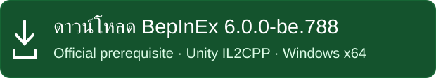
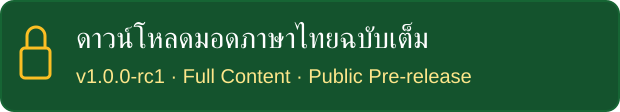
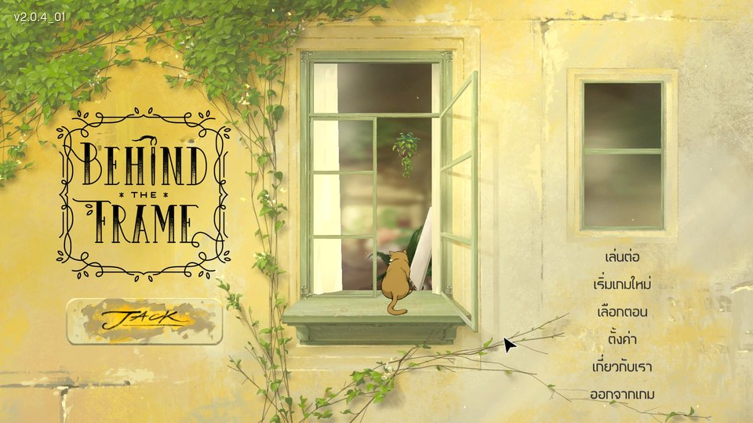
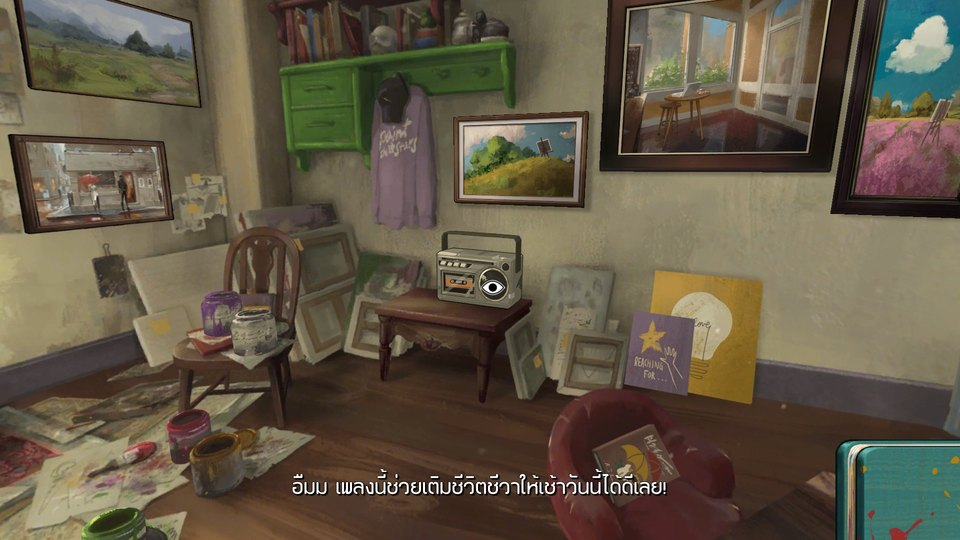
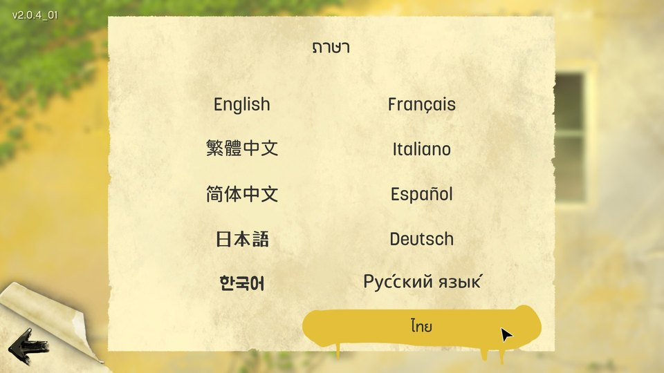

# Behind the Frame: The Finest Scenery — มอดภาษาไทย

[English](README_EN.md) · [ติดตั้งทีละขั้น](docs/INSTALL_TH.md) · [ภาพตัวอย่าง](docs/SCREENSHOTS.md) · [แก้ปัญหา](docs/TROUBLESHOOTING_TH.md)

**มอดภาษาไทยโดย TA Font** · แพ็ก1.0.0-rc1 · ปลั๊กอิน0.7.21 · Public Pre-release
ทดลองแล้วสามารถใช้ได้ทั้งตัวเกมบน Steam และ Epic Games Store

## วิธีติดตั้ง
ดาวน์โหลด ZIP ทั้งสองจากปุ่มด้านบน แล้วทำตามขั้นตอนนี้:

1. ติดตั้งตัวเกมผ่าน Steam หรือ Epic Games Store 
2. แตกไฟล์ในโฟลเดอร์ BepInEx ไปไว้ที่เดียวกับไฟล์ .EXE ของตัวเกม
3. เปิดเกมจากหน้า Steam หรือ Epic Games Store หนึ่งครั้งก่อน ในขั้นตอนนี้จะมี **BepInEx console** หน้าจอสีดำๆ รายงานการติดเตรียมติดตั้ง BepInEx ปรากฏขึ้น ให้รอสักพักจนกว่าจะเสร็จ จนเกมเริ่มต้นขึ้นตามปกติ
4. ให้ออกจากเกม แล้วแตกไฟล์ใน BehindTheFrameThai_v1.0.0-rc1_FULL.zip ที่โหลดมา ไปไว้ที่เดียวกับไฟล์ .EXE ของตัวเกม
5. เปิดเกมผ่าน Steam หรือ Epic Games Launcher → เข้าหน้าเมนู **Settings / ตั้งค่า → Language / ภาษา → ไทย** 

[คู่มือติดตั้งพร้อมทุกขั้นตอน](docs/INSTALL_TH.md) · [สำรองมอดเก่า/ถอน/ย้อนกลับ](docs/BACKUP_UNINSTALL_TH.md)

มีมอดเดิมอยู่แล้วให้สำรอง **DLL + Font Bundle + Localization/Artwork + Config** เป็นชุดไว้นอกเกมก่อน ไม่ลบทั้ง plugins ไม่ทับไฟล์มอดอื่น และไม่แตะ Save/Steam Cloud

## ภาพตัวอย่างภาษาไทย

[ดูแกลเลอรีเพิ่มเติม](docs/SCREENSHOTS.md)

[รู้จักเกม Behind the Frame — ประวัติ เนื้อเรื่อง และความน่าสนใจ](docs/ABOUT_GAME_TH.md) · [เกมทางการบน Steam](https://store.steampowered.com/app/1634150/)

## มอดนี้มีอะไรบ้าง?
- คำแปล 703 รายการ
- ฟอนต์ที่ออกแบบเองให้เข้ากับแนวทางเกม และระบบจัดวางสระ–วรรณยุกต์ไทย
- ภาพสมุด/จดหมายไทย 34 รายการ และ Cinema ไทย 3 ชุด / 12 เฟรม
*ต้องมีเกมแท้ถูกต้อง มอดนี้ไม่เป็นทางการและไม่อ้างการรับรองจากทีมผู้สร้าง

## ปัญหาที่พบ และ ข้อมูลเพิ่มเติมที่น่าสนใจ
-ออกจากบทกลับเมนูแล้วเข้า **บทเดิมอีกครั้งโดยยังไม่ปิดเกม** บางครั้งหน้าหมายเลขบทแสดงปกติ แต่ภาพดำเมื่อควรเข้าฉากเล่น เสียงและเมาส์อาจยังทำงาน นี่ไม่ใช่พื้นดำปกติช่วง Loading/ชื่อบท ลองปิดเกมแล้วเปิดใหม่ก่อนเข้าอีกครั้งอาจช่วยได้ แต่ไม่รับประกัน เคยพบขณะปิดมอด/เส้นทางโหลด BepInEx ด้วย สาเหตุยังไม่ทราบ ไม่กล่าวโทษมอดหรือเกมและไม่อ้างว่าแก้แล้ว

- ถ้าเกมเดิมจอดำตั้งแต่เริ่ม **ให้หยุดติดตั้งมอดก่อน** อ่าน [เกมเปิดแล้วจอดำตั้งแต่เริ่ม — วิธีตรวจสอบและแก้ไขเบื้องต้น](docs/STARTUP_BLACK_SCREEN_TH.md) ไม่ต้องรีเซต Registry ทุกครั้งที่ลงเกม ขั้นตอนนี้ไม่เกี่ยวกับจอดำหลังเข้าบทเดิมซ้ำ

- หากคัตซีนบางช่วงไม่เล่น ผู้จัดจำหน่ายแนะนำให้เปลี่ยน **H.264 → VP8** ใน Settings สำหรับบางเครื่อง [อ่านขอบเขตคำแนะนำ](docs/TROUBLESHOOTING_TH.md#video-codec) · [ประกาศต้นฉบับ8กรกฎาคม2022](https://steamcommunity.com/games/1634150/announcements/detail/3335495035148049868) 

## ขอบคุณและสิทธิ์
ขอขอบคุณฟอนต์ Worasait (วรเศรษฐ) - ใช้ฟอนต์ ฟอนต์ Worasait ประกอบการออกแบบข้อความลายมือภาษาไทยในภาพประกอบของมอดนี้

[Worasait — หน้าเว็บฟอต์](https://www.f0nt.com/release/worasait/)

เกมโดย **Silver Lining Studio**; ผู้จัดจำหน่าย **Akupara Games / Akatsuki Taiwan Inc.** 
มอดแปลโดยแฟนเกม แจกฟรี ไม่เป็นทางการ และไม่ได้เกี่ยวข้องหรือรับรองโดยผู้พัฒนาหรือผู้จัดจำหน่าย

[ติดต่อเรื่องสิทธิ์หรือขอให้นำเนื้อหาออก](https://github.com/IsAmArt/Behind-the-Frame-The-Finest-Scenery---MOD-Thai/issues)

[เครดิตและสิทธิ์ทั้งหมด](credits/CREDITS.md) · [Third-party notices](THIRD_PARTY_NOTICES.md) · [Release notes](release/RELEASE_NOTES_TH.md)
