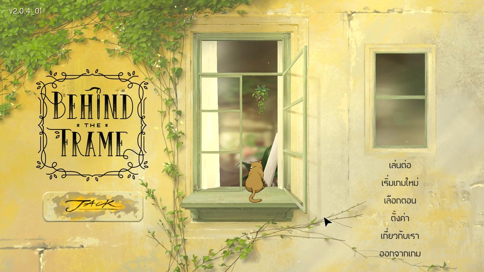
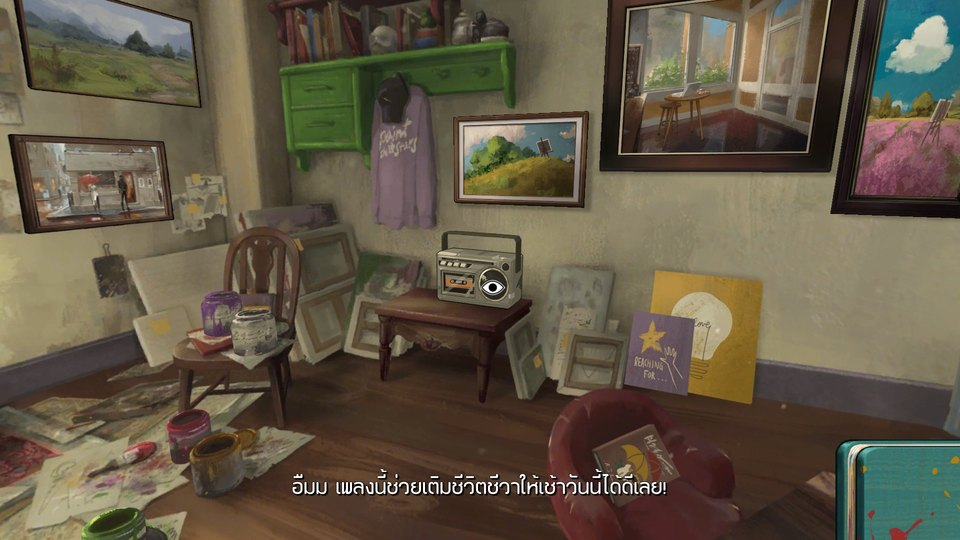
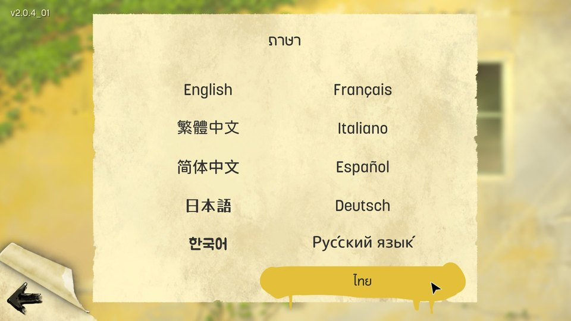

# Behind the Frame: The Finest Scenery — Full Thai Localization Mod

[](https://builds.bepinex.dev/projects/bepinex_be/788/BepInEx-Unity.IL2CPP-win-x64-6.0.0-be.788%2B5b766a3.zip)

[](https://github.com/IsAmArt/Behind-the-Frame-The-Finest-Scenery---MOD-Thai/releases/download/v1.0.0-rc1/BehindTheFrameThai_v1.0.0-rc1_FULL.zip)

[ภาษาไทย](README.md) · [Step-by-step install](docs/INSTALL_EN.md) · [Screenshots](docs/SCREENSHOTS.md) · [Troubleshooting](docs/TROUBLESHOOTING_EN.md)

**Thai mod by TA Font** · Package1.0.0-rc1 · Plugin0.7.21 · Public Pre-release

**Full Content — Public Pre-release** · Complete Thai content, not a fully certified stable release

Unofficial free fan translation by TA Font. Includes the complete Thai content; exact-public-package gameplay QA is incomplete. Read the known issues before installation.

## Discover the game

Help a painter complete her work, explore her surroundings and follow a story through pictures and puzzles. [Spoiler-light introduction, history and story (Thai)](docs/ABOUT_GAME_TH.md) · [Official Steam page](https://store.steampowered.com/app/1634150/)

## Thai mod screenshots

User-supplied gameplay captures: click a preview for its full-size copy. Historical screenshots are not gameplay QA of this public ZIP. Rightsholder permission for screenshots has not been confirmed; see credits.

[](assets/screenshots/thai-menu.jpg)

[](assets/screenshots/thai-dialogue.jpg)

[](assets/screenshots/thai-language.jpg)

[More screenshots](docs/SCREENSHOTS.md)

## Included

- 703 translation entries with approved Phase05H/QA06 context corrections.
- TAMolly font and Thai mark shaping.
- 34 notebook/letter images, updated AmberLetter images, and3 Cinema sets/12 frames.
- 50 gameplay/config files; no original game, BepInEx binaries or standalone TTF/OTF fonts bundled.

Requires a legitimate game copy. This is unofficial and does not claim developer endorsement. The user reported completing the game with generally working Thai, but **this exact public ZIP still needs user runtime QA**.

## First: make sure the original game launches

1. Install the Steam game and reach its menu **without mods or BepInEx** first. Existing users should follow [backup/vanilla recovery](docs/BACKUP_UNINSTALL_EN.md), not delete files by guesswork.
2. If the menu works, close the game; only then download/install pinned BepInEx below.
3. Launch once to check BepInEx separately (first startup may take longer), close the game, then download/extract the Thai ZIP and copy its files.

If the original game is black at startup, **stop mod installation** and read [Startup black screen — initial checks and recovery](docs/STARTUP_BLACK_SCREEN_EN.md). Do not reset the Registry on every installation. This is separate from same-chapter re-entry black screens.

Online instructions were updated after the v1.0.0-rc1 ZIP: use the latest GitHub installation/recovery guides. The existing ZIP and mod files are unchanged.

## Installation for beginners

Download both ZIPs using the buttons above, then:

1. Prepare Steam Windows x64 and **two ZIPs**: the pinned BepInEx prerequisite and the Thai mod.
2. Steam → **Library** → right-click game → **Properties… → Installed Files → Browse…**. Find **Behind the Frame.exe**, possibly inside **BehindTheFrame_PC_Steam**.
3. Close the game. Right-click BepInEx ZIP → **Extract All… → Extract**. Open it and copy the archive's contents beside the EXE. Confirm **winhttp.dll** and **BepInEx** are at the same level as the EXE.
4. After vanilla reaches the menu, launch once to generate/check BepInEx files separately (first launch can take longer), then **close it** before installing the mod.
5. Extract the mod outside the game; open its package folder until README and **BepInEx** appear. Copy this **BepInEx** into the EXE folder, merging it. Do not create **BepInEx/BepInEx** nesting.
6. Launch through Steam → **Settings → Language → ไทย**. No New Game or save reset is required.

Before → after (schematic, not a screenshot):

```text
Before: EXE folder/                 After: same folder/
        Behind the Frame.exe              Behind the Frame.exe
        Behind the Frame_Data/            winhttp.dll     ← BepInEx
                                          BepInEx/
                                            config/       ← mod config
                                            plugins/      ← DLL + bundle + translation/art
```

[Detailed guide](docs/INSTALL_EN.md) · [Backup/update/uninstall/rollback](docs/BACKUP_UNINSTALL_EN.md). Existing users must back up the matching **DLL + bundle + translation/artwork + config** outside the game first. Never delete all plugins, overwrite another mod's files or change saves/Steam Cloud.

## Tested scope

Historically tested **Steam Windows x64 · Unity IL2CPP2019.4.18f1 · BepInEx6.0.0-be.788 · plugin0.7.21**. Do not substitute Mono/x86/BepInEx5 or an arbitrary Latest build. **Epic: NOT SUPPORTED / NOT VALIDATED** — the original Epic game previously showed a startup black screen; it has not been retested since the owner changed Registry settings and Steam began working. No mod QA exists there. Other stores/builds, macOS/Linux/Proton/SteamDeck and VR are untested.

## Known issues

Returning from a chapter to the main menu and selecting **that same chapter again without closing the game** may show the chapter number normally, then black imagery when gameplay should appear. Audio/input may continue. This is separate from ordinary black Loading/title screens. Closing and reopening before re-entry may help but is not guaranteed. It also occurred in plugin-/loader-disabled controls; cause UNKNOWN, no blame or fix claimed.

The first ESC popup flashing/disappearing and historical Chapter6/Continue problems are separate. [Known Issues](KNOWN_ISSUES.md) · [Troubleshooting](docs/TROUBLESHOOTING_EN.md) · [FAQ (Thai)](docs/FAQ_TH.md)

## Thanks and rights

Thank you to **Worasait (วรเศรษฐ)** for releasing a handwriting font for free **noncommercial** use. TA Font used it in parts of the mod's Thai handwritten artwork. [Creator's page](https://www.f0nt.com/release/worasait/). This is separate from TAMolly and original-game credits; no commercial/OFL/public-domain permission is implied and no Worasait.ttf is bundled.

Original developer **Silver Lining Studio**; publishers **Akupara Games / Akatsuki Taiwan Inc.** Unofficial free fan translation, not affiliated with or endorsed by the developer or publishers. The project owner authorized publication of this complete mod; permission from the game rightsholders for the translation,31 original-derived artwork files and screenshots has NOT been confirmed. Attribution or willingness to remove material is not a substitute for permission. This is not a blanket MIT/OFL/public-domain package.

[Rights-holder concerns or removal requests](https://github.com/IsAmArt/Behind-the-Frame-The-Finest-Scenery---MOD-Thai/issues)

[Credits and permissions](credits/CREDITS.md) · [Third-party notices](THIRD_PARTY_NOTICES.md) · [Release notes](release/RELEASE_NOTES_EN.md)
