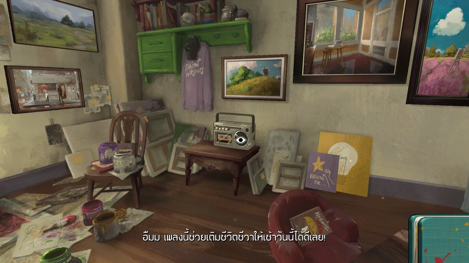

# ข้อมูลที่น่าสนใจและเนื้อเรื่องของเกม Behind the Frame: The Finest Scenery

[กลับหน้าแรก — มอดภาษาไทย Behind the Frame](../README.md) · [ภาพตัวอย่างมอด](SCREENSHOTS.md)

ช่วยจิตรกรสาวเติมแต่งสีภาพวาด และค่อยๆ ปะติดปะต่อเรื่องราวผ่านงานศิลปะ และปริศนา ให้คุณค่อยๆ ค้นพบเรื่องราวด้วยตัวเอง 

## Behind the Frame คือ?

เกมผจญภัยเล่าเรื่อง (Narrative Adventure) ที่ให้ลงมือทำสิ่งเล็กๆ ในชีวิตจิตรกร เป็นทั้งเรื่องเล่าแบบมีปฏิสัมพันธ์ (Interactive Fiction) เกมปริศนา และการวาดภาพ ผู้เล่นจะค่อยๆ สังเกต เก็บรายละเอียด และเติมสีให้งานที่กำลังสร้าง โดยไม่ต้องแข่งขันกับใคร
โดยมี จิตรกรสาวที่กำลังสร้างผลงานชิ้นสุดท้ายเพื่อส่งให้แกลเลอรี คุณจะต้องช่วยเธอวาดภาพ แก้ปริศนา และสำรวจสิ่งรอบตัว ระหว่างวันยังมีเพื่อนบ้าน แมว และรายละเอียดชวนให้นึกถึงความทรงจำต่างๆ ปรากฏอยู่รอบห้อง เรื่องเล่าจะค่อยๆเผยผ่านสิ่งเล็กๆ น้อยๆ
[หน้าเกมทางการ](https://silverliningstudio.co/Behindtheframe/index.html)
**Silver Lining Studio** ผู้พัฒนา **Akupara Games** และ **Akatsuki Taiwan Inc.** จัดจำหน่าย เกมวางจำหน่ายครั้งแรก **25 สิงหาคม 2021** ที่หน้า Steam  [ข้อมูล Steam](https://store.steampowered.com/app/1634150/)

## จุดเด่นและความน่าสนใจ
- **งานภาพและแอนิเมชันวาดมือ** ทำให้ห้องและวัตถุมีลักษณะคล้ายภาพวาดที่ขยับได้
- **ฉากพาโนรามา360องศา** ชวนให้หันมองรอบตัวและสังเกตมุมเล็ก ๆ
- **วาดภาพและเติมสี** เป็นกิจกรรมที่เชื่อมกับการดำเนินเรื่อง
- **ปริศนาที่อยู่ในเรื่องเล่า** ชวนเก็บ ซ่อม และทำความเข้าใจสิ่งที่พบ
- **ดนตรีและบรรยากาศผ่อนคลาย** อยู่คู่กับการสำรวจในจังหวะของผู้เล่น
- **รายละเอียดเล็ก ๆ** เป็นส่วนหนึ่งของการค่อย ๆ ทำความเข้าใจเรื่องราว

รายละเอียดด้านพาโนรามาและปริศนามาจาก [เว็บไซต์เกม](https://silverliningstudio.co/Behindtheframe/index.html) ส่วนงานวาดมือ การเติมสีและบรรยากาศอยู่ใน [หน้า Steam](https://store.steampowered.com/app/1634150/)

## เกมนี้เหมาะกับใคร?
**ความเห็นเชิงแนะนำ:** น่าลองสำหรับคนชอบเกมเนื้อเรื่อง งานภาพ ศิลปะ ปริศนาที่ไม่เน้นการต่อสู้ และเรื่องราวเกี่ยวกับความทรงจำหรือความสัมพันธ์ ถ้าชอบค่อย ๆ มองสิ่งของและตีความด้วยตนเอง รูปแบบนี้อาจตรงใจ ส่วนคนที่ต้องการการต่อสู้หรือความท้าทายรวดเร็วเป็นหลักควรชมตัวอย่างทางการก่อนตัดสินใจ

## ผู้เล่นจะได้รับประสบการณ์อะไร?
**มุมมองประกอบการเลือกเล่น:** จุดน่าสนใจคือการได้ใช้เวลากับบรรยากาศ สังเกตงานภาพ และค่อย ๆ ผูกเหตุการณ์เข้าด้วยกัน ความผูกพันและการตีความต่างกันได้ในผู้เล่นแต่ละคน ไม่จำเป็นต้องอ่านเรื่องย่อที่เฉลยทุกอย่างก่อนเริ่ม หน้านี้ไม่อ้างว่าเกมมีผลบำบัดหรือให้ผลทางสุขภาพ

## รายละเอียดตัวเกม
| รายการ | ข้อมูลและขอบเขต |
|---|---|
| ชื่อ | Behind the Frame: The Finest Scenery |
| แนว | Steam จัด Adventure / Casual / Indie; ลักษณะการเล่นเป็น narrative puzzle / interactive fiction / painting |
| ผู้พัฒนา | Silver Lining Studio |
| ผู้จัดจำหน่ายบน Steam | Akupara Games, Akatsuki Taiwan Inc. |
| วางจำหน่ายครั้งแรก | 25 August2021 / 25สิงหาคม2021 |
| แพลตฟอร์มตัวเกม | หน้า Steam ระบุ Windows/macOS; ผู้จัดจำหน่ายระบุ Steam, Switch, PlayStation, iOS และ Android |
| เอนจิน | Unity สำหรับเกม Steam ที่เคยตรวจในโครงการมอด; ไม่ใช่คำยืนยันจากหน้าเว็บทางการ |
| มอดภาษาไทยชุดนี้ | ทดสอบใช้งานเบื้องต้นสำเร็จทั้ง Steam และ Epic Games Store บน Windows x64 โดยผู้จัดทำ; ไม่ครบทุกบท/build และไม่ใช่มอดสำหรับทุกแพลตฟอร์มตัวเกม |

ข้อมูลเกมอ้าง [Steam](https://store.steampowered.com/app/1634150/) และ [Akupara Games](https://www.akuparagames.com/game/behind-the-frame-the-finest-scenery/) วันออกคอนโซลอาจต่างจากวันออกครั้งแรก ทดสอบใช้งานเบื้องต้นสำเร็จทั้ง Steam และ Epic Games Store บน Windows x64 โดยผู้จัดทำ (31ตุลาคม2026) ไม่สรุปว่าSteam/Epic binaryเหมือนกัน และยังไม่รับรองQAครบถ้วน

## ข้อมูลเพิ่มเติมที่น่าสนใจ — ปัญหาคัตซีนและ Video Codec
### Video Codec
ประกาศ **Behind the Frame Post-Launch Update** ของผู้จัดจำหน่ายวันที่ **8กรกฎาคม2022** ระบุว่าผู้เล่นบางรายเจอคัตซีนไม่เริ่ม/เล่นผิดปกติ และแนะนำเปลี่ยน **H.264 → VP8** ในเมนูตั้งค่า โดยกล่าวถึงSteamDeckเป็นกรณีที่เกี่ยวข้อง

ถ้าเข้าเมนูได้แต่คัตซีนมีปัญหา ให้จดค่าปัจจุบัน ไป **Settings/ตั้งค่า → Video Codec** (บางUIใช้ชื่อVideo Format/รูปแบบวิดีโอ) แล้วเลือก **VP8** ผู้เล่นเป็นผู้ทดสอบเองและบันทึกผล ถ้าไม่ดีขึ้นให้หยุดและเก็บข้อมูล อย่าแก้ไฟล์หรือข้อมูลเกมเพื่อบังคับcodec

นี่เป็นคำแนะนำแก้การเล่นคัตซีนสำหรับบางเครื่อง **ไม่ใช่ผลยืนยันว่าแก้จอดำตั้งแต่เปิด หรือจอดำหลังเข้าบทเดิมซ้ำ** และไม่ใช่การรับรองมอดบนSteamDeck

[ประกาศต้นฉบับโดยผู้จัดจำหน่าย](https://steamcommunity.com/games/1634150/announcements/detail/3335495035148049868) · [กลับไปแยกอาการstartup](STARTUP_BLACK_SCREEN_TH.md)

## แหล่งข้อมูลและลิงก์ทางการ
ตรวจข้อมูลเว็บเมื่อ31ตุลาคม2026:
- [Behind the Frame — เว็บไซต์เกมโดย Silver Lining Studio](https://silverliningstudio.co/Behindtheframe/index.html)
- [Silver Lining Studio — เว็บไซต์ทีมผู้สร้าง](https://silverliningstudio.co/index.html)
- [Behind the Frame — Akupara Games](https://www.akuparagames.com/game/behind-the-frame-the-finest-scenery/)
- [Behind the Frame — ร้านค้า Steam](https://store.steampowered.com/app/1634150/)

ลิงก์เหล่านี้ใช้ตรวจข้อมูลและเข้าถึงเกมทางการ ไม่ใช่การรับรองมอดหรือการให้สิทธิ์เผยแพร่ภาพดัดแปลง นโยบายวิดีโอ/สตรีมของสตูดิโอไม่ได้ถูกนำมาเหมารวมเป็นอนุญาตเผยแพร่ภาพมอด

## กลับหน้าแรกมอดภาษาไทย
[กลับหน้าแรก — มอดภาษาไทย Behind the Frame](../README.md)
