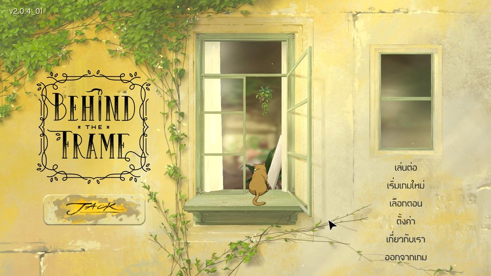
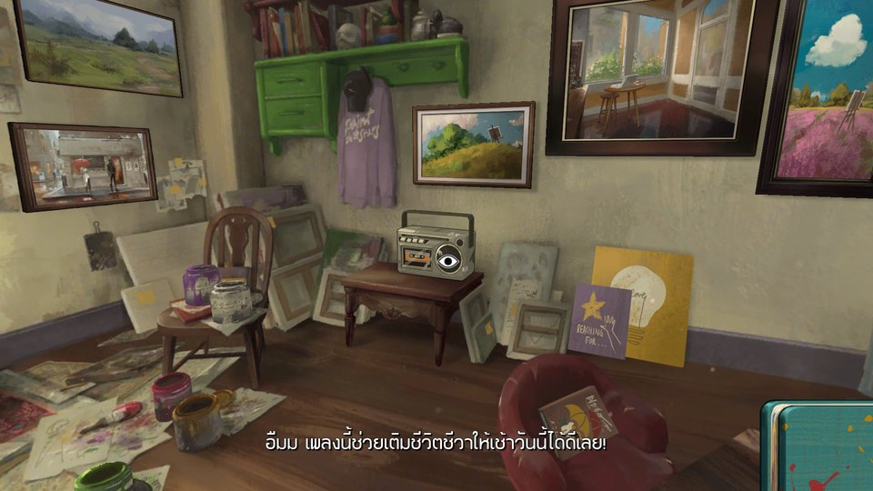
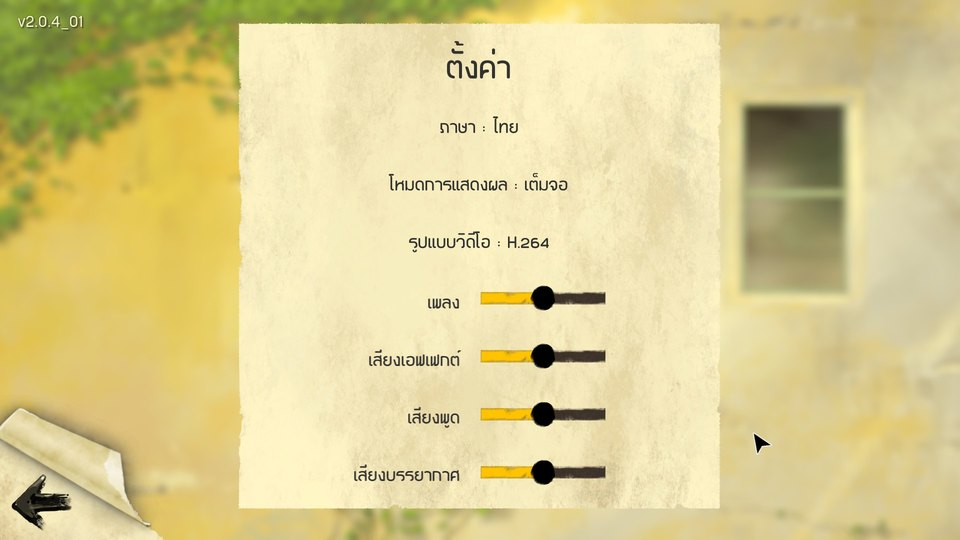
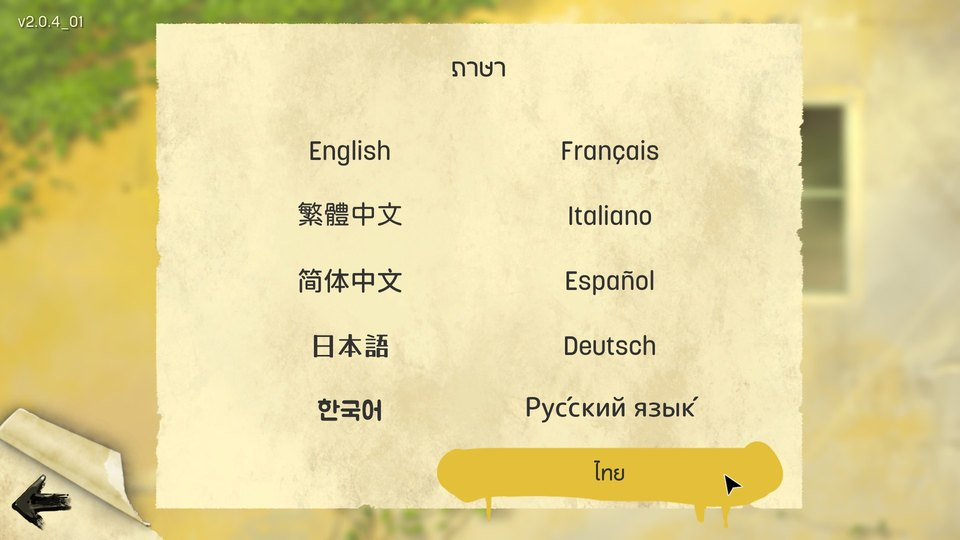

# ภาพตัวอย่างมอด / Screenshots

[หน้าแรก](../README.md) · [English README](../README_EN.md) · [รู้จักเกม](ABOUT_GAME_TH.md)

ภาพหน้าจอจากเกมที่ผู้ใช้จัดเตรียม สิทธิ์จากเจ้าของลิขสิทธิ์ยังไม่ได้รับการยืนยัน / Rightsholder permission for these screenshots has not been confirmed. [เครดิตและสิทธิ์ / Credits and rights](../credits/CREDITS.md)

ภาพจริงจากการเล่นที่ผู้ใช้จัดเตรียม ไม่ใช่ภาพจำลอง คลิกภาพย่อเพื่อดูสำเนาขนาด1920×1080 ภาพเก่าเหล่านี้แสดงหน้าตามอด ณ เวลาที่บันทึก **ไม่ได้ยืนยันว่า ZIP เผยแพร่ชุดนี้ผ่าน QA** ไม่มีภาพ Cinema ในโฟลเดอร์ต้นทางจึงไม่ใส่ภาพแทนจากชุด private review/reference

These are user-supplied gameplay captures, not mockups. Click each960×540 preview for its1920×1080 original-quality copy. Historical captures are not gameplay QA of this exact public ZIP. No Cinema capture was available in the designated source folder; private-review/reference images are excluded.

## เมนูหลักภาษาไทย / Thai main menu

## ห้องวาดภาพและข้อความภาษาไทย / Painting room and Thai dialogue

## หน้าตั้งค่าภาษาไทย / Thai settings

## เลือกภาษาไทยในเมนูภาษา / Thai language selection

เกมต้นฉบับโดย Silver Lining Studio; จัดจำหน่ายโดย Akupara Games และ Akatsuki Taiwan Inc. มอดไทยโดย TA Font · [เกมทางการบน Steam](https://store.steampowered.com/app/1634150/)
